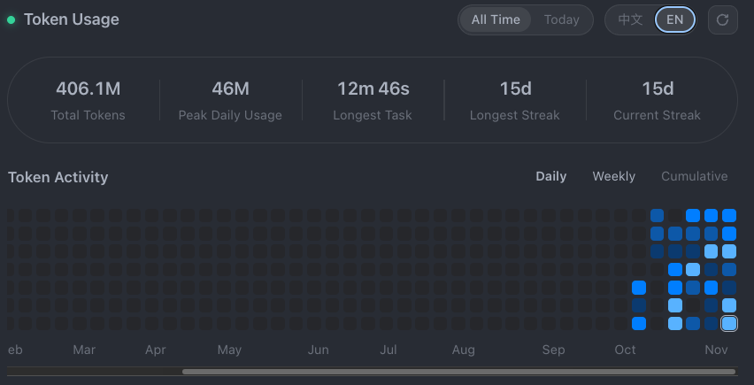

# Antigravity Token Usage (`token-usage`)

A native **Antigravity 2.0** Plugin + Sidecar that brings a **Codex-style local token usage dashboard** directly into the Antigravity sidebar and conversation auxiliary pane.

[中文说明](#中文说明)



---

## Features

- **Native Antigravity 2.0 Integration**:
  - `SIDECAR_UI_ENTRYPOINT_SIDEBAR`: Full-pane view listed under the left sidebar's **Plugins** section.
  - `SIDECAR_UI_ENTRYPOINT_AUX_PANE`: Compact side-panel view accessible right beside any conversation.
- **Codex-Style 5-KPI Summary Strip**:
  - Total Tokens · Peak Daily Usage · Longest Task Duration (active execution time, filtering out >10 min idle/error gaps) · Longest Streak · Current Streak.
- **Unified 53×7 Activity Matrix**:
  - **Daily**: 53-week × 7-day blue-intensity heatmap; click any square to inspect that day's sessions.
  - **Weekly**: 7-block vertical equalizer per week column.
  - **Cumulative**: Step-up cumulative growth matrix.
- **All Time / Today Toggle & Bilingual UI (`中文 / EN`)**:
  - Switch between all-time totals and today's new usage, and toggle Chinese / English UI with `localStorage` persistence.
- **100% Local & Read-Only**:
  - Reads `~/.gemini/antigravity/brain/*/.system_generated/logs/transcript.jsonl` and `conversation_summaries.db` (read-only) with `(mtime, size)` + `etag` caching. Zero external network requests.

## Installation

Clone directly into your global Antigravity plugins directory:

```bash
git clone https://github.com/Kisxl/antigravity-token-usage.git ~/.gemini/config/plugins/token-usage
```

Then open **Plugins** in Antigravity (or restart Antigravity) to enable **Token Usage**.

---

## 中文说明

专为 **Antigravity 2.0** 桌面端打造的原生 `Plugin + Sidecar` 本地 Token 监控面板，复刻 Codex 极简暗色点阵风格：

- **双原生入口**：支持左侧边栏 `Plugins` 独立全屏页（`SIDEBAR`）与对话右侧辅助面板（`AUX_PANE`）。
- **核心指标与三视图矩阵**：顶部 5 项 KPI（累计 Token 数、单日峰值、最长任务用时、最长连续天数、当前连续天数）+ 53×7 点阵热力图（每天 / 每周 / 累计总量），点击任意日期可下钻当日会话并直接点击跳转对应对话。
- **范围与语言切换**：支持 `总计 / 今日新增` 与 `中文 / EN` 实时切换。
- **纯本地只读**：仅读取本机 `~/.gemini/antigravity/` 日志与 SQLite 摘要库，无任何外部网络请求。

### 安装方式

```bash
git clone https://github.com/Kisxl/antigravity-token-usage.git ~/.gemini/config/plugins/token-usage
```
